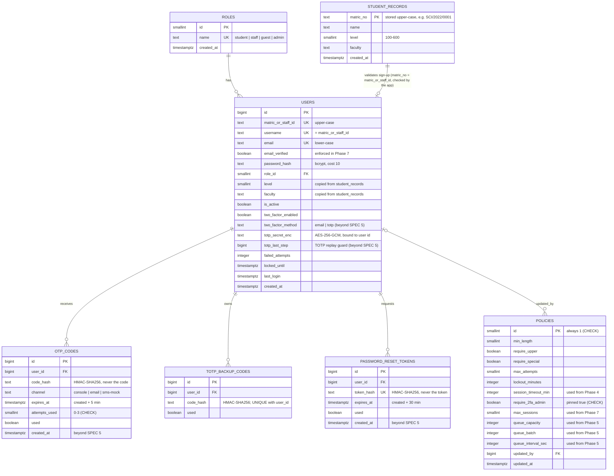

# Data model (as built, end of Phase 2)

PostgreSQL tables created by the migrations in `db/migrations/`. Columns marked *(beyond SPEC §5)* were added during the build and approved in the phase plans. Redis keys are listed after the diagram (they are not tables).

**Constraints worth mentioning in the report**
- `users`: `two_factor_enabled` is true exactly when `two_factor_method` is set; `two_factor_method = 'totp'` requires `totp_secret_enc`; `failed_attempts >= 0`; IDs and emails must be stored normalized.
- `policies`: a single row (`id = 1`); `require_2fa_admin` cannot be false (FR-A13); value ranges are checked.
- Child tables (`otp_codes`, `totp_backup_codes`, `password_reset_tokens`) are deleted with their user (`ON DELETE CASCADE`).

**Redis keys (shared by all app processes)**

| Key | Holds | Lifetime |
|---|---|---|
| `cg:preauth:<HMAC of ticket>` | pre-auth ticket: user id, method, attempts | 5 min |
| `cg:acct:<HMAC of ticket>` | interim account ticket: user id, role, scope (removed in Phase 4) | 10 min |
| `cg:preauth:user:<id>`, `cg:acct:user:<id>` | index of a user's tickets, for revocation | same as tickets |
| `cg:totp-pending:<user id>` | TOTP secret during enrolment, encrypted | 10 min |
| `cg:cooldown:otp:<purpose>:<user id>` | OTP resend cooldown | 60 s |
| `cg:cooldown:reset:<HMAC of email>` | reset-email cooldown | 60 s |
| `cg:metrics:*` | counters (reset emails sent/failed, notification failures) | permanent |
| `cg:sms-mock:outbox` | sms-mock messages (development only) | last 200 |

Planned in later phases (not built yet): `services`, `role_permissions`, `policy_history`, `auth_logs` (Phase 3); `sessions` (Phase 4); `access_windows`, `guest_vouchers`, `email_verifications` (Phase 7).
